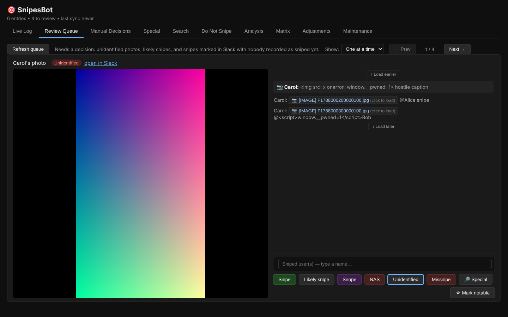
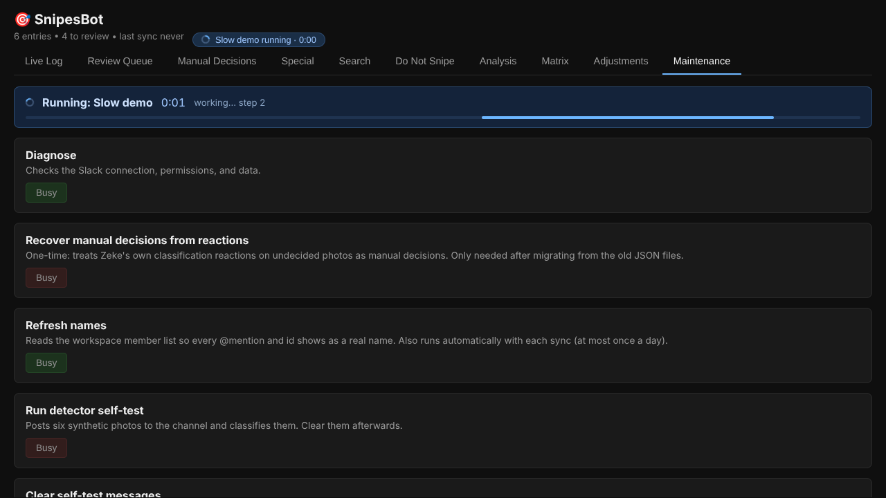

# SnipesBot

A Slack bot for the Cornell Astronomical Society's `#snipes` channel. It reads
photo captions, classifies each one (snipe, snope, not-a-snipe, …), reacts with
a status emoji, keeps a leaderboard, and comes with an admin web UI for
reviewing and correcting what the bot decided.

```
Slack ──events──▶  bot (app.py)  ──▶  services  ──▶  SQLite (data/snipesbot.db)
                        ▲                               ▲        + archive files
                        └── background loop            │
                            (sync · review DMs)         │
                                                        │
Browser ──▶  admin webapp (webapp.py) ──▶ services ─────┘
```

Both processes share one database. SQLite in WAL mode with transactional
read-modify-write means they can write at the same time without losing each
other's changes.

## Quick start

```sh
python -m venv venv && . venv/bin/activate
pip install -r requirements.txt
cp .env.example .env            # fill in the tokens

python -m snipesbot migrate     # ONLY if upgrading from the JSON version; see MIGRATING.md
python app.py                   # the Slack bot
python webapp.py                # the admin UI  →  http://127.0.0.1:8420
```

The webapp binds to loopback by default. To expose it, set `WEBAPP_PASSWORD`
(HTTP Basic, any username) and `WEBAPP_HOST`; it refuses to start exposed
without a password. Systemd units are in `deploy/`.

Slack app requirements are unchanged: Socket Mode, the bot scopes the old
version used (`channels:history`, `reactions:read/write`, `files:read`,
`chat:write`, `users:read`, `im:write`, `commands`), and the
`message`, `reaction_added` **and `reaction_removed`** event subscriptions
(the last is new: un-starring a photo now un-marks it as notable).

## Where the data lives

Everything is under one directory, `SNIPESBOT_DATA_DIR` (default `data`):

```
data/
  snipesbot.db            entries, messages, settings, do-not-snipe, scoring
  archive/files/          every photo/video, named by Slack file id (F0123ABC.jpg)
```

**The default `data` is relative to the directory you start the process from** (it is resolved to an absolute path at startup),
so the bot, the webapp and CLI commands must all be started from the same
place (the systemd units set `WorkingDirectory`) or all given the same absolute
`SNIPESBOT_DATA_DIR`. Two different working directories means two different,
separate databases.

If photos show as missing, run `python -m snipesbot diagnose`. It prints the
absolute paths in use, how many photos the database can find, and examples of
the ones it can't, and it works even without network access. To reconnect
files that exist elsewhere on disk:

```sh
python -m snipesbot relink-files /path/to/old/data     # searches recursively
```

It matches files named by Slack file id (`F0123ABC.jpg`, the archive's naming)
or by entry id (the old `photos/` folder's naming). A photo whose file is gone
from your disk *and* older than Slack's retention window can't be recovered;
anything Slack still has is re-downloaded the first time you open it.

## How a photo is judged

Classification uses only the photo's own caption. Rules, in order:

| Caption | Result |
|---|---|
| contains a snope word | **snope** |
| `@mention` + a snipe word | **snipe** — counts toward the score |
| only `@mention`s, nothing else | **likely snipe** — needs confirming |
| `@mention` mixed with other text, or no mention | **unidentified** — needs a human |

Keywords match whole words, case-insensitively, and a negated keyword
(*"not a snipe"*, *"no snipe"*) doesn't count. The bot reacts with a matching
emoji: 🟢 snipe · 🟣 snope · 🟠 likely · ❓ unidentified · ⚫ not a snipe ·
🔴 missnipe · 🫆 special.

**Manual decisions always win.** Anything a person decides (by reacting as
Zeke, replying `#snipe @someone` in the thread, using the review DM, or using
the webapp) is locked: edits and sync never change it. Zeke's reactions:

| Reaction | Effect |
|---|---|
| 🟢 / 🟣 / ⚫ | set snipe / snope / not-a-snipe (not over a missnipe) |
| 🔴 | missnipe — only on a confirmed snipe |
| 🟠 | confirm a likely snipe as a snipe |
| ❓ | lock a pending photo as unidentified |
| 🫆 | send to the **Special** tab |
| ⭐ | notable (Zeke's star, or 3+ other people's; removable) |

## Admin UI

Live Log · Review Queue · Manual Decisions · Special · Search · Do Not Snipe ·
Analysis · Matrix · Compare · Adjustments · Maintenance.

**Roster.** The Matrix, Adjustments and Compare grids list only people @ed in
the snipes channel, people who post in or belong to it, and people on the
do-not-snipe list (plus anyone who already has a manual number). The cached
workspace directory is used for *names*, never to decide who is on the roster.
Channel membership is cached from Slack once a day (needs `channels:read`; without it,
posters and @mentions still count).

**Matrix (True view)** is live-editable: cells, each person's Adjustment, and
their Score. Totals recompute as you type; typing a Score stores the Adjustment
that reaches it.

**Compare** holds the bot against a human read-through of the whole chat. Enter
or paste the human's matrix and adjustments; the tab lists every cell that
differs (Human − Bot: positive = bot missed, negative = over-counted), the photos
worth re-checking for mislabels, and a one-click remedy that writes the needed
Manual correction so True equals Human. Cells aimed at do-not-snipe people are
flagged and skipped by "apply all". The human numbers never feed the live
leaderboard on their own.

**Analysis** opens with the current logic of every analysis (single source:
`analysis/logic.py`); all rankings are sorted highest to lowest.

**Review Queue** holds everything that needs a decision: unidentified photos,
likely snipes, and **snipes with nobody recorded as sniped**. That last group is
what you get when you mark a photo green with a Slack reaction (there's nowhere
to say who). It stays a snipe, keeps its green reaction, scores nothing, and
waits here, labelled *"Snipe — who was sniped?"*, until you pick the people.
In Slack, `/reviewsnipes` includes them too.

**One at a time** (the *Show* menu; your choice is remembered per tab) puts the
photo, the conversation and the buttons on one screen, with no scrolling, and
the ← → keys step through the queue:



**Names, not ids.** Every id is shown as a name: in captions, context, replies,
cards, the Live Log, analysis, exports and CLI output. Slack's own formatting is
decoded too (`<@U1>` → `@Name`, `<#C1|general>` → `#general`, `<!here>`,
links, `&amp;`). A sync caches the whole workspace member list (once a day, or
run **Refresh names** in Maintenance; it needs the `users:read` scope). Two people
with the same name get a short id suffix so they can be told apart; hover a
name in the Live Log for the id.

**Running tasks are obvious.** Starting a Maintenance task shows a banner with a
spinner, a ticking timer, the latest output line and a progress bar; every other
button reads *Busy*; and a pill in the header shows it from any tab. It survives
switching tabs and reloading. A sync started elsewhere (the bot's scheduled
pass, the CLI) shows up the same way.



**Do-not-snipe.** A snipe that tags someone on the list is still logged as a
snipe (streaks, the Live Log, activity stats), but it earns **neither the sniper
nor the target any points**: that sniper→target pair is left out of every matrix
and the leaderboard. In a group snipe the other victims still score. It's marked
*no points* in the UI, listed under Analysis → *No-points snipes*, and the
export has a *Scores* column. This follows the list as it is **now**: adding
someone applies to all their snipes, removing them makes those score again.
The bot still posts its public warning and DMs the sniper (who is told it won't score).

Scoring is layered: the **Coded** matrix (what was classified) plus a
**Manual** matrix (hand corrections, can be negative) gives the **True**
matrix, from which Snipes/Sniped come. Score = Snipes − Sniped + a per-person
**Adjustment**.

## Sync, archive and maintenance

Slack's free tier hides old messages and files, so everything seen is copied
into a permanent local archive and read from there ever after (photos,
context and thread replies all come from it).

One job does all the upkeep (`snipesbot/services/sync.py`): archive new
messages → record any photo not yet tracked → re-run the rules on automatic
entries → notice photos deleted while the bot was offline. It runs every few
hours by itself, and on demand:

```sh
python -m snipesbot sync                       # continue from the last pass
python -m snipesbot sync --since 2026-09-01
python -m snipesbot sync --full                # rescan the whole season
python -m snipesbot sync --repair-reactions    # ask Slack about every reaction (slow)
python -m snipesbot export log.xlsx            # the spreadsheet is an export now
python -m snipesbot stats | diagnose | selftest | selftest-clear
```

The same tasks are in the webapp's **Maintenance** tab. A cross-process lock
means only one sync runs at a time, wherever it was started.

## Layout

```
snipesbot/
  config.py        settings, loaded explicitly (no import-time side effects)
  models.py        Kind enum, Entry dataclass
  classifier.py    pure caption → classification
  db.py            SQLite connection, transactions, schema migrations
  store/           data access: entries, archive (messages+files), small stores
  services/        entries (THE state-transition path), sync, archiver, dns,
                   notify, context, exports, legacy import, maintenance registry
  slack_app/       Bolt listeners → services; reactions policy table; review UI
  analysis/        Stats over one snapshot of the data
  web/             Flask app: auth, serializers, api/*; static ES modules
tests/             pytest suite + jsdom frontend smoke test
app.py  webapp.py  thin entry points (the old systemd units still work)
```

The one rule that keeps this tidy: **everything that changes a photo's
classification goes through `services.entries.apply_state`**. It updates the
row in one transaction, then fixes the Slack reaction and runs the
do-not-snipe check. Callers only decide *what* the new state is.

## Tests

```sh
pip install -r requirements-dev.txt
python -m pytest                  # ~185 tests, ~2s
sh tests/frontend/run.sh          # real frontend code in jsdom (needs Node 20+)
```

The suite uses a fake Slack client and a temp database. It covers the
classifier, store, every state transition, the sync job (including *how many
Slack calls it makes*), the Slack handlers, all web endpoints, scoring, the
importer, and the frontend's escaping of hostile Slack text.

## Configuration

See `.env.example`; every variable is documented there.
